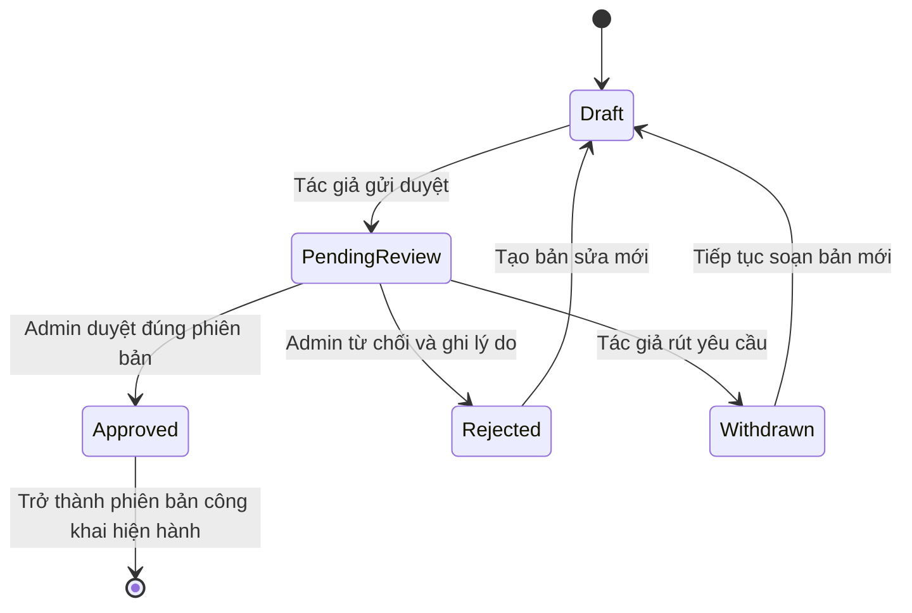

# Forum cộng đồng — Phân tích nghiệp vụ

Ngày: 14/11/2026. Phạm vi: discovery và yêu cầu nghiệp vụ, chưa triển khai Forum.

Phương pháp: áp dụng skill [business-analyst](https://github.com/Xpos587/agent-skills/blob/main/skills/business-analyst/SKILL.md): xác định vấn đề/người dùng, phỏng vấn quyết định quan trọng, phân tích luồng và quy tắc, tiêu chí nghiệm thu, rủi ro và bàn giao. Đã đọc SKILL.md trực tiếp; chưa cài skill hay chạy script của repo. Phân tích kỹ thuật và các tình huống kiểm duyệt đã được rà độc lập trước khi tổng hợp.

## 1. Vấn đề và giá trị

Ứng dụng đã cho người dùng khám phá ảnh bầu trời, nhưng cần một không gian thảo luận để đặt câu hỏi, trao đổi cách đọc ảnh, bàn về mục tiêu và chia sẻ liên kết quan sát. Người dùng chính là học sinh, sinh viên và người yêu thiên văn; nhóm vận hành cần giữ nội dung đúng chủ đề và xử lý nội dung không phù hợp.

Forum tạo vòng sử dụng: khám phá trong The Eyes -> chia sẻ câu hỏi/nhận xét -> cộng đồng thảo luận -> quay lại quan sát. Admin kiểm duyệt bài trước khi công khai; bình luận có hậu kiểm để thảo luận diễn ra thuận tiện.

Duyệt đăng nghĩa là đáp ứng quy tắc cộng đồng. Không đồng nghĩa xác minh phát hiện khoa học, bảo đảm mọi nhận định đúng, hoặc được NASA công nhận. Câu hỏi của người mới không bắt buộc phải có kết luận khoa học.

## 2. Các quyết định đã được người dùng xác nhận

| ID | Quyết định |
| --- | --- |
| D01 | Có Forum thảo luận chủ đề liên quan sản phẩm/thiên văn; bài đăng phải được admin duyệt trước khi công khai. |
| D02 | Có bình luận; bình luận hiện ngay, có báo cáo và admin có thể ẩn khi cần. |
| D03 | Khi sửa bài đã công khai, bản đã duyệt vẫn hiển thị; bản sửa chỉ thay thế sau khi admin duyệt. |
| D04 | Hashtag lấy từ danh mục do admin quản lý; thành viên không tự tạo hashtag mới. |
| D05 | Khách chưa đăng nhập được đọc bài đã công khai và bình luận; viết bài, bình luận và báo cáo cần đăng nhập. |
| D06 | Bản đầu hỗ trợ văn bản và liên kết, gồm link quan sát The Eyes. Tải ảnh lên để giai đoạn sau. |

Các con số giới hạn, danh sách hashtag, nội dung thông báo và cách sắp xếp bên dưới là đề xuất để triển khai, không phải quyết định người dùng đã chọn riêng từng mục.

## 3. Hiện trạng hệ thống đã kiểm tra

- React/TypeScript/Vite; router có bốn trang sản phẩm cùng login/signup và các alias. Chưa có route Forum hoặc khu duyệt bài.
- `frontend/src/features/auth/authService.ts` hiện mô phỏng đăng nhập/đăng ký, chỉ trả email sau delay, không có backend xác thực. `AuthForm.tsx` có dòng “Demo only: accounts are not saved yet.”
- Chưa có session dùng chung, user ID bền vững, role admin hoặc guard xác thực trong phần FE được kiểm tra.
- Header/menu/footer dùng chung danh sách navigation trong `frontend/src/shared/layout/Shell.tsx`; có thể thêm Community/Forum nhất quán tại đây.
- Có TanStack Query và hệ tokens/layout để tái sử dụng.

Kết luận: có thể dựng UI/luồng Forum với mock, nhưng Forum production cần backend xác thực, phân quyền, lưu bền và kiểm duyệt. Route guard FE hoặc dữ liệu role trong trình duyệt không đủ để bảo vệ quyền duyệt bài.

Forum là phạm vi mở rộng mới sau bốn trang ban đầu; không ép các màn cộng đồng/admin vào bốn route cũ và không thiết kế lại chúng chỉ để thêm tính năng này.

## 4. Vai trò và quyền

| Hành động | Khách | Thành viên | Admin |
| --- | --- | --- | --- |
| Đọc/tìm kiếm/lọc bài công khai và xem bình luận đang hiển thị | Có | Có | Có |
| Viết nháp, gửi bài để duyệt | Đăng nhập trước | Bài của mình | Có, theo chính sách tác giả |
| Đọc nháp, bản chờ, lý do từ chối | Không | Chỉ bài của mình | Phục vụ kiểm duyệt |
| Rút yêu cầu đang chờ, sửa và gửi lại | Không | Bài của mình | Không sửa âm thầm nội dung tác giả |
| Đề xuất sửa bài công khai | Không | Bài của mình | Không tự đổi nội dung người khác |
| Bình luận / báo cáo | Đăng nhập trước | Có | Có |
| Duyệt / từ chối bài | Không | Không | Có |
| Ẩn / khôi phục bài hoặc bình luận | Không | Không | Có, có lịch sử và lý do |
| Tạo/sửa/ngừng sử dụng hashtag | Không | Không | Có |

Admin là quyền do hệ thống/nhóm vận hành cấp, không có lựa chọn “Đăng ký làm admin”. Khi xác định tác giả hoặc reviewer, backend dùng user ID từ session, không tin `author_id`/`role` do FE gửi.

Đề xuất: hiển thị tác giả bằng tên công khai, không dùng email đăng nhập làm tên xuất hiện trên Forum. Cần bổ sung display name vào hồ sơ trước khi người dùng đóng góp lần đầu.

## 5. Phạm vi bản đầu

### Bắt buộc

- Danh sách bài công khai; tìm theo tiêu đề/nội dung và lọc hashtag.
- Trang chi tiết bài với tác giả, ngày đăng, mốc chỉnh sửa, hashtag, nội dung, liên kết và bình luận.
- Soạn nháp, xem trước, gửi duyệt; vùng “My posts” theo dõi trạng thái và lý do từ chối.
- Sửa bài đã đăng thông qua bản sửa chờ duyệt; bản công khai cũ vẫn còn.
- Bình luận hiện ngay; báo cáo bài/bình luận; admin xử lý và ẩn/khôi phục.
- Hàng đợi admin, xem bản gửi cụ thể, so sánh bản sửa, duyệt hoặc từ chối có lý do.
- Admin quản lý danh mục hashtag; thông báo kết quả duyệt trong ứng dụng.
- Auth/session/role thực khi phát hành; mọi quyền được kiểm tra ở backend.

### Đề xuất cho MVP để giữ phạm vi gọn

- Bình luận một cấp, chưa có luồng trả lời lồng nhiều tầng.
- Feed mặc định mới đăng trước; “My posts” theo cập nhật mới nhất; hàng đợi theo lần gửi cũ nhất trước.
- Lọc một hashtag mỗi lần, kết hợp với từ khóa; URL giữ bộ lọc và phân trang.
- Editor văn bản hoặc Markdown giới hạn, có liên kết và preview; chưa có raw HTML, ảnh/video/file upload.
- Chưa thêm like, vote, bookmark, follow, điểm thưởng, chat riêng, email/push hay gợi ý bằng AI.
- Không sửa/xóa bài của tác giả âm thầm bằng quyền admin; admin yêu cầu sửa hoặc ẩn, mọi quyết định có log.

Các chức năng mở rộng không được trình bày như tính năng đã được người dùng yêu cầu hoặc hệ thống đã có.

## 6. Mô hình bài và phiên bản

Tách **bài** (định danh, tác giả, trạng thái hiển thị) khỏi **phiên bản nội dung** (title/body/hashtag/link gửi duyệt).

Một bài có tối đa một phiên bản công khai hiện hành, và một bản nháp hoặc chờ duyệt đang xử lý. Phiên bản đã gửi duyệt được giữ bất biến. Muốn sửa khi đang chờ phải rút yêu cầu, tạo/cập nhật bản nháp rồi gửi lại.

Sơ đồ thể hiện luồng công việc; snapshot đã bị từ chối/rút vẫn được lưu, không bị sửa ngược thành bản nháp để xóa lịch sử.

### Lần đăng đầu

1. Thành viên viết title/body, chọn hashtag, thêm liên kết nếu có.
2. Lưu nháp hoặc xem trước. Nút “Submit for review” ghi rõ bài chưa được đăng ngay.
3. Sau gửi, tác giả thấy “Pending review”; khách và thành viên khác không thấy bài.
4. Admin đọc snapshot đang chờ, chọn Approve hoặc Reject.
5. Approve làm phiên bản này công khai và thông báo tác giả. Reject giữ bài riêng tư, trả lý do cho tác giả sửa/gửi lại.

### Sửa bài đã công khai

1. Thành viên tạo bản sửa từ phiên bản đang công khai.
2. Trong khi bản sửa ở Draft/Pending review, công chúng tiếp tục thấy bản đã được duyệt.
3. Admin xem bản hiện hành và phần thay đổi, gồm cả hashtag và liên kết.
4. Duyệt bản sửa thay thế phiên bản hiện hành bằng một thao tác nhất quán; không tạo bài trùng mới.
5. Từ chối/rút bản sửa không ảnh hưởng bản đang công khai. Thay hashtag cũng phải đi theo quy trình này.

Đề xuất: giữ nguyên ngày đăng đầu và danh tính bài, thêm “Edited” theo lần duyệt bản sửa. Bình luận vẫn gắn với cùng bài; lưu mốc/phiên bản khi bình luận để có thể giải thích ngữ cảnh sau thay đổi.

### Ẩn bài là một quyết định khác với duyệt phiên bản

Trạng thái hiển thị bài: Unpublished, Published, Hidden. Admin ẩn bài khi có vấn đề sau đăng; nội dung không còn truy cập công khai qua URL, feed, tìm kiếm, hashtag hoặc bình luận. Tác giả được biết lý do. Duyệt một bản sửa không tự khôi phục một bài đã Hidden; khôi phục cần hành động quản trị rõ ràng.

## 7. Quy tắc kiểm duyệt

- Admin phải duyệt đúng revision đã xem; không duyệt một bản nội dung có thể thay đổi sau khi tải màn hình.
- Từ chối/ẩn phải có lý do, được lưu cùng reviewer và thời gian. Lý do chi tiết chỉ hiển thị cho tác giả và admin.
- Đề xuất nhóm lý do: không đúng chủ đề; spam; nội dung xúc phạm; lộ thông tin cá nhân; cần bổ sung ngữ cảnh/nguồn; lý do khác có diễn giải. Cần có hướng dẫn cộng đồng ngắn, dễ hiểu.
- Admin không tự viết lại bài dưới tên tác giả. Có thể phản hồi điều cần sửa và từ chối để tác giả gửi bản mới.
- Nếu hai admin cùng xử lý, quyết định hợp lệ đầu tiên được ghi nhận; người xử lý sau nhận trạng thái mới, không ghi đè. Tương tự khi tác giả đã rút yêu cầu.
- Gửi lại/double click không tạo quyết định hoặc bài công khai trùng.
- Audit log gồm actor, hành động, bài, revision, thời gian, lý do và trạng thái trước/sau.
- Đề xuất: bài do admin viết cũng theo cùng quy trình; nếu muốn ngoại lệ tự xuất bản phải quy định riêng, không tự suy ra từ role.

## 8. Bình luận và báo cáo

- Thành viên đã đăng nhập bình luận trên bài đang công khai; nội dung hiện ngay theo quyết định D02.
- Bình luận không được gửi vào nháp/bài chờ/bài Hidden. Backend kiểm tra trạng thái tại lúc gửi, kể cả khi trang đã mở từ trước.
- Admin có thể ẩn/khôi phục bình luận và ghi lý do. Nội dung ẩn không trả về cho người xem công khai.
- Thành viên báo cáo bài hoặc bình luận với loại lý do và mô tả bổ sung. Đề xuất một báo cáo đang mở cho mỗi người đối với cùng đối tượng để hạn chế gửi lặp.
- Báo cáo có trạng thái Open / Resolved / Dismissed. Nội dung bị báo cáo không tự biến mất chỉ vì có nhiều báo cáo; admin xem và quyết định.
- Danh tính người báo cáo và nội dung xử lý nội bộ không hiển thị công khai.
- Báo cáo hoặc bình luận không phải đường tắt để gửi nội dung vào feed chính mà bỏ kiểm duyệt bài.

## 9. Hashtag

Admin quản lý tag có ID ổn định, slug duy nhất, tên hiển thị và trạng thái Active/Inactive. Thành viên chọn từ danh mục Active; không tự tạo tag bằng cách gõ một giá trị mới. Chuỗi `#` gõ trong nội dung không tự tạo quan hệ phân loại.

Đề xuất khởi đầu: `#spherex`, `#moving-stars`, `#variable-stars`, `#brown-dwarfs`, `#image-analysis`, `#observing-tips`, `#questions`.

- Đề xuất 1–5 tag mỗi bài; admin quản lý danh mục riêng, không tự đổi hashtag của revision đã gửi.
- Chuẩn hóa trường tìm kiếm/slug để `SPHEREx`, `spherex`, `#spherex` không sinh chủ đề trùng.
- Bộ lọc và số bài theo tag chỉ tính bài/phiên bản đang công khai; không đếm bản nháp, bản chờ hoặc một bản sửa thành bài mới.
- Đề xuất ngừng tag thay vì xóa lịch sử sử dụng; bài cũ vẫn có tag và lọc được, bài mới không chọn thêm tag Inactive.
- Nếu tag bị ngừng khi một bản đang chờ duyệt, admin phải nhìn thấy trạng thái đó và yêu cầu tác giả đổi nếu chính sách không cho xuất bản. Không sửa tag âm thầm trong lúc duyệt.

## 10. Màn hình và user stories

| Màn hình đề xuất | Người dùng cần làm được |
| --- | --- |
| `/forum` | Đọc bài, tìm kiếm/lọc tag, phân trang, xem empty/error/loading, bắt đầu viết bài |
| `/forum/posts/:id` | Đọc bản công khai, xem/bình luận, báo cáo, mở link quan sát, thấy mốc chỉnh sửa |
| `/forum/new` và editor của bài riêng | Lưu nháp, preview, chọn tag, gửi duyệt; xác nhận khi rời nội dung chưa lưu |
| `/forum/my-posts` | Xem Draft/Pending/Published/Rejected/Hidden; phân biệt bài Published đang có bản sửa chờ |
| Vùng riêng của bài/bản sửa | Xem lý do, rút yêu cầu, sửa/gửi lại; nội dung chỉ tác giả/admin có quyền |
| `/admin/forum` | Xem hàng đợi, so sánh revision, duyệt/từ chối, xử lý báo cáo, quản lý tag |

Route chỉ là đề xuất. Có thể tách tab admin/tag/report thành route con khi thiết kế, không cần dashboard thống kê lớn để hoàn thành MVP.

Luồng sau login cần giữ `returnTo` nội bộ và nội dung soạn dở khi thích hợp. Khi logout/đổi tài khoản, cache “My posts”, bản nháp riêng và hàng đợi admin phải được xóa hoặc phân scope đúng. Không hiển thị dữ liệu của tài khoản trước cho tài khoản sau.

Forum dùng tokens/font hiện có: Averia Serif Libre cho tiêu đề, nội dung/control dễ đọc, ít artwork trong vùng bài và editor. Navigation thêm Forum/Community theo layout hiện tại; giữ trải nghiệm của các trang khám phá.

## 11. Thông tin và phụ thuộc cần có

### Dữ liệu nghiệp vụ

User/profile; Post; PostRevision; Hashtag và quan hệ với revision; Comment; Report; ModerationDecision/AuditEvent; Notification. Admin review và public API phải biết chính xác revision công khai hiện hành.

Nội dung public được trả từ phiên bản đã duyệt. Nội dung chưa duyệt không xuất hiện trong response public, preview/metadata, kết quả tìm kiếm hoặc bộ đếm. UI ẩn một khối không thay thế kiểm tra quyền ở API.

### Giới hạn đề xuất

Title 10–150 ký tự; body 20–20.000 ký tự; bình luận 1–3.000 ký tự; 1–5 hashtag. Kiểm tra và chuẩn hóa ở cả FE và BE; backend là nơi quyết định. Các giới hạn cần thống nhất trong hợp đồng trước khi code, không được suy ra là yêu cầu đã xác nhận.

Đề xuất Markdown hạn chế hoặc plain text với liên kết an toàn, escape/sanitize nội dung, không thực thi HTML/script. Phân trang và kiểm soát gửi lặp/spam ở backend. Tải ảnh lên không thuộc bản đầu nên chưa cần pipeline upload.

### Phụ thuộc thực tế

1. Backend auth/session, user ID, display name và quyền admin; quy trình cấp tài khoản admin đầu tiên.
2. Lưu bền các entity và kiểm tra quyền sở hữu/role/trạng thái trên từng request.
3. Hợp đồng Forum riêng; không gộp vào API xử lý ảnh SPHEREx.
4. API kiểm duyệt hỗ trợ revision/version để giải quyết thao tác đồng thời; công khai và cập nhật bộ lọc/count/cache nhất quán.
5. Notification trong app cho gửi duyệt, duyệt, từ chối và ẩn; email chưa thuộc MVP.
6. Tiêu chí cộng đồng và người phụ trách hàng đợi thật. Số lượng admin/lịch trực cần thống nhất khi tổ chức vận hành, không chặn phân tích/UI.

## 12. Tiêu chí nghiệm thu

| ID | Given / When / Then |
| --- | --- |
| AC01 | Khách mở Forum -> chỉ thấy bài đã xuất bản, có thể đọc bình luận công khai và lọc tag; thao tác đóng góp dẫn tới login. |
| AC02 | Thành viên gửi bài hợp lệ -> thấy Pending review trong My posts; người khác không tìm/đọc được bản đó kể cả biết URL. |
| AC03 | Admin duyệt revision đang chờ -> bản đúng được công khai một lần; tác giả nhận trạng thái/thông báo; feed và tag cập nhật. |
| AC04 | Admin từ chối -> yêu cầu lý do; bài chưa công khai; tác giả thấy lý do và tạo bản sửa gửi lại. |
| AC05 | Bài đã công khai có bản sửa -> public tiếp tục thấy bản cũ; bản mới và hashtag mới không rò rỉ trước duyệt. |
| AC06 | Bản sửa được duyệt -> thay phiên bản hiện hành; bị từ chối/rút -> bản công khai cũ không đổi. |
| AC07 | Tác giả rút khi admin đang đọc hoặc hai admin cùng xử lý -> thao tác stale không ghi đè, không duyệt sai revision; UI tải lại trạng thái. |
| AC08 | Thành viên bình luận bài công khai -> bình luận hiện ngay; người chưa đăng nhập hoặc bài Hidden không tạo được bình luận. |
| AC09 | Admin ẩn bài/bình luận -> public API, URL, search/tag/cache không còn trả nội dung đó; có log và lý do. Duyệt bản sửa không tự khôi phục bài Hidden. |
| AC10 | Chọn hashtag -> chỉ từ danh mục hợp lệ; nhập chuỗi trong body không tạo tag mới; tag counts không tính nội dung chưa xuất bản. |
| AC11 | Thành viên sửa request/URL để xem nháp người khác hoặc duyệt bài -> backend từ chối, không chỉ ẩn nút trên FE. |
| AC12 | Logout/đổi tài khoản -> không còn bản nháp/hàng đợi/thông báo riêng của tài khoản trước trong UI/cache. |
| AC13 | Báo cáo hợp lệ -> vào hàng đợi riêng; reporter không lộ công khai; gửi lặp không tạo spam; nội dung không tự ẩn vì số report. |
| AC14 | Người đọc mở liên kết quan sát -> về đúng mục tiêu/selection mà link chứa; không cần có dữ liệu từ bài để tự suy ra kết quả khoa học. |

## 13. Mục tiêu đo lường và rủi ro

Release gate đề xuất: toàn bộ AC về quyền, revision, không lộ nội dung chờ duyệt và luồng duyệt chính phải đạt; không có trường hợp xuất bản bỏ qua quyết định admin.

Sau release theo dõi: tỷ lệ bắt đầu viết -> gửi duyệt; số bài/bình luận thực; thời gian chờ duyệt trung vị và các bài chờ lâu; tỷ lệ từ chối theo lý do; tỷ lệ báo cáo đã xử lý. Chưa đặt con số tăng trưởng hoặc SLA tùy ý khi chưa biết lưu lượng và lịch admin; thống nhất baseline/target trước vận hành.

Rủi ro chính: auth hiện mới mock; hàng đợi thiếu người duyệt; bản sửa vượt kiểm duyệt; lộ nội dung riêng qua cache/search; nội dung thảo luận bị hiểu là kết quả khoa học đã xác nhận. Các quy tắc revision, quyền backend, nhãn nguồn và quy trình vận hành ở trên là điều kiện xử lý các rủi ro này.

## 14. Bàn giao sang thiết kế/triển khai

Các quyết định nghiệp vụ cốt lõi đã được xác nhận ở mục 2. Có thể chuyển sang đặc tả UI/API và backlog theo thứ tự:

1. Chốt auth/session/role thực và profile; chọn contract/data store cùng BE owner.
2. Forum public + trang chi tiết + taxonomy.
3. Editor/My posts + submission/revision workflow.
4. Admin review, so sánh phiên bản và audit log.
5. Comments/reports, in-app notifications và đồng bộ trạng thái.
6. Kiểm thử permission/revision/concurrency, tích hợp thật và deploy.

Cần chốt thêm khi thiết kế chi tiết: giới hạn nội dung, danh mục tag đầu tiên, copy hướng dẫn cộng đồng, cách cấp admin và hợp đồng/backend triển khai. Các mục này không làm thay đổi năm quyết định luồng đã xác nhận. Không có mã Forum, migration, auth hay deploy nào được thực hiện trong lần phân tích này.
