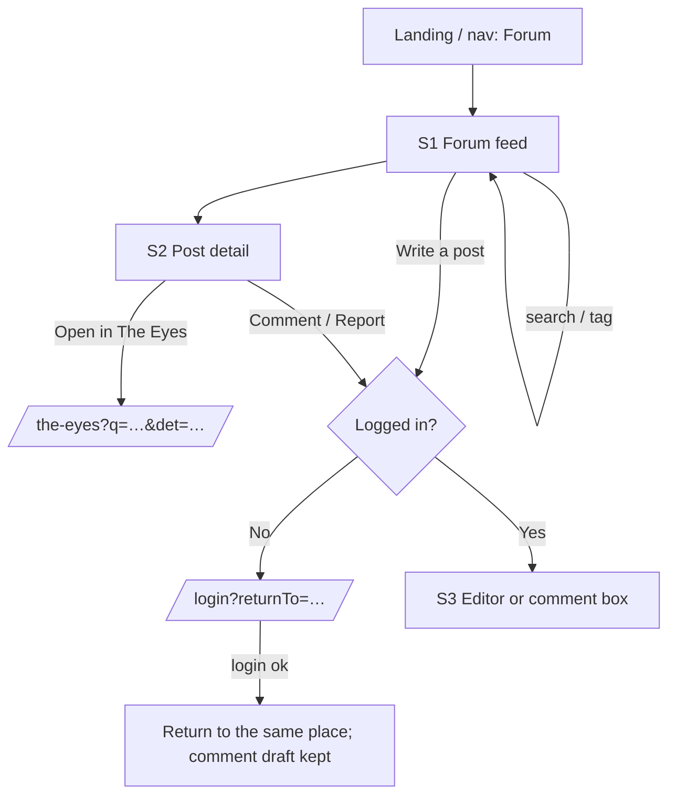
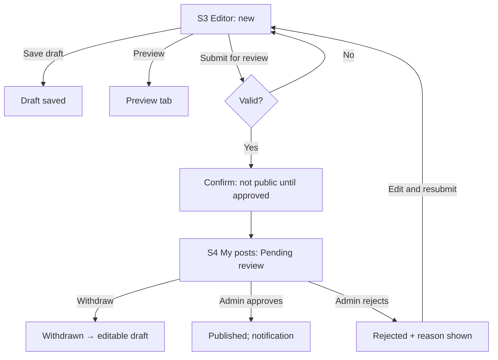
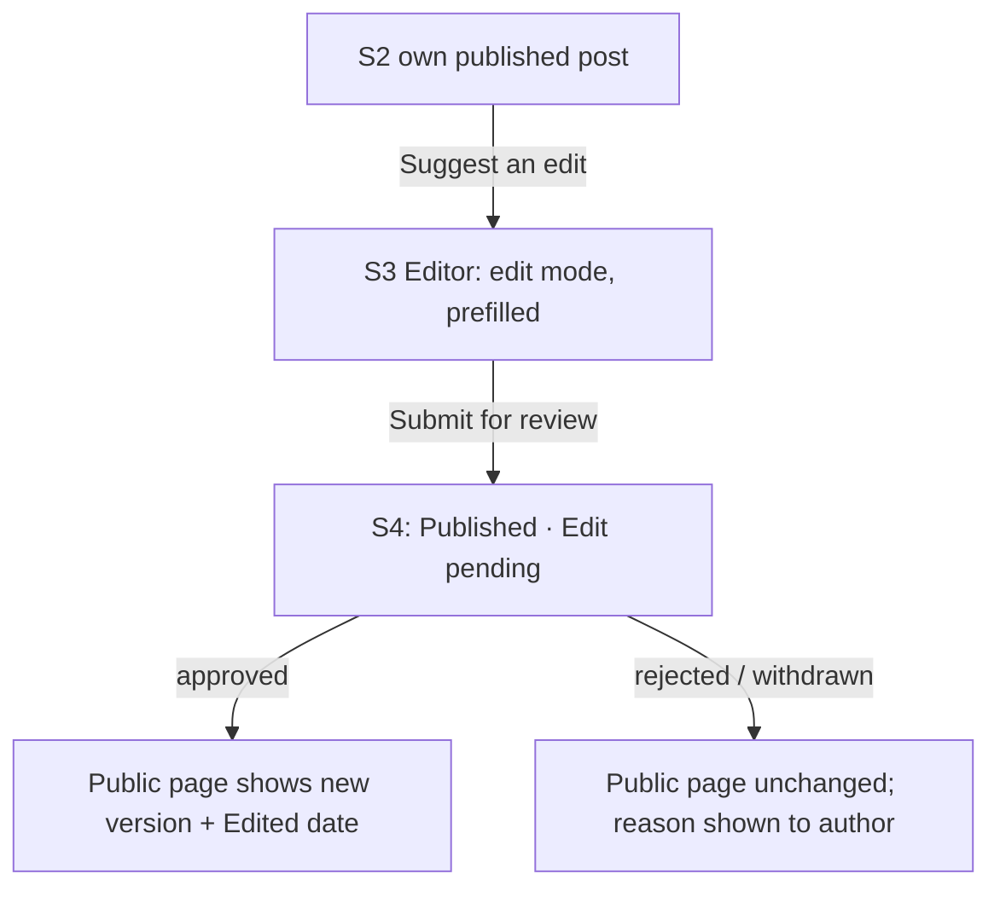
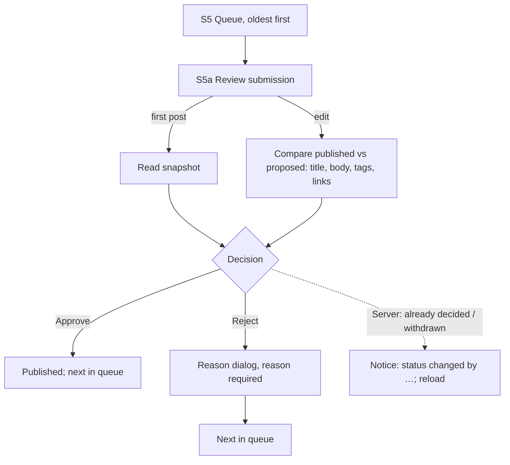

# Forum cộng đồng: phân tích UI

Ngày: 14/11/2026. Đầu vào: `docs/FORUM_BUSINESS_ANALYSIS.md` (bản duy nhất tìm thấy trong repo), `docs/DESIGN.md`, mã nguồn `frontend/src` trên nhánh `duy-hoang/new-frontend`.
Trạng thái: **phân tích, chưa thiết kế chi tiết, chưa code.** Phương án giao diện nằm ở `UI_DESIGN_PROPOSALS.md`.

Công cụ: skill `ui-ux-pro-max` (tra cứu mẫu Forum/Discussion và các quy tắc UX; không sinh design system mới vì dự án đã có), `frontend-design` (nguyên tắc tránh giao diện khuôn mẫu). Kết quả tra cứu chỉ dùng làm tham khảo; `DESIGN.md` và requirement được ưu tiên.

---

## 1. Tóm tắt yêu cầu (Phase 1)

### 1.1. Tổng quan tính năng

| Mục | Nội dung | Nguồn |
| --- | --- | --- |
| Mục tiêu | Chỗ để người dùng hỏi, trao đổi cách đọc ảnh SPHEREx, bàn về mục tiêu và chia sẻ link quan sát | BA §1 |
| Vấn đề | Hiện chỉ khám phá một mình trong The Eyes; không có nơi hỏi hoặc chia sẻ | BA §1 |
| Người dùng chính | Học sinh, sinh viên, người yêu thiên văn (thường là người mới) | BA §1 |
| Người vận hành | Admin giữ nội dung đúng chủ đề, xử lý vi phạm | BA §1 |
| Giá trị | Vòng lặp: khám phá trong The Eyes → chia sẻ → thảo luận → quay lại quan sát | BA §1 |
| Giới hạn ý nghĩa | "Đã duyệt" = đúng quy tắc cộng đồng, **không** = phát hiện khoa học được xác minh hay NASA công nhận | BA §1 |

**Hệ quả cho UI:** phải có nhãn rõ ràng để bài đã duyệt không bị hiểu là kết quả khoa học đã xác nhận. Đây là rủi ro được nêu trong BA §13.

### 1.2. Yêu cầu đã xác nhận (người dùng đã chốt)

| ID | Quyết định | Ảnh hưởng UI |
| --- | --- | --- |
| D01 | Bài phải được admin duyệt trước khi công khai | Nút gửi ghi rõ "Submit for review", có trạng thái Pending; cần màn duyệt cho admin |
| D02 | Bình luận hiện ngay; có báo cáo; admin ẩn được | Ô bình luận đăng thẳng; có hành động Report; admin có Hide/Restore |
| D03 | Sửa bài đã công khai: bản cũ vẫn hiện tới khi bản sửa được duyệt | My posts phải phân biệt "Published + có bản sửa chờ duyệt"; admin cần xem so sánh |
| D04 | Hashtag lấy từ danh mục admin; thành viên không tạo mới | Ô chọn tag chỉ chọn trong danh sách, không có ô gõ tự do; admin có màn quản lý tag |
| D05 | Khách được đọc; viết, bình luận, báo cáo phải đăng nhập | Nút đóng góp hiện cho khách nhưng dẫn tới login rồi quay lại |
| D06 | Bản đầu chỉ có văn bản và liên kết, gồm link quan sát The Eyes | Không có upload; cần cách hiển thị link The Eyes |

### 1.3. Phạm vi bắt buộc của bản đầu (BA §5)

| ID gán | Yêu cầu |
| --- | --- |
| FR-01 | Danh sách bài công khai; tìm theo tiêu đề/nội dung; lọc theo hashtag |
| FR-02 | Trang chi tiết: tác giả, ngày đăng, mốc chỉnh sửa, hashtag, nội dung, liên kết, bình luận |
| FR-03 | Soạn nháp, xem trước, gửi duyệt |
| FR-04 | "My posts": theo dõi trạng thái và lý do từ chối |
| FR-05 | Sửa bài đã đăng qua bản sửa chờ duyệt; bản cũ vẫn công khai |
| FR-06 | Bình luận hiện ngay |
| FR-07 | Báo cáo bài/bình luận; admin xử lý; ẩn/khôi phục |
| FR-08 | Hàng đợi admin; xem đúng bản gửi; so sánh bản sửa; duyệt/từ chối có lý do |
| FR-09 | Admin quản lý danh mục hashtag |
| FR-10 | Thông báo kết quả duyệt trong ứng dụng |
| FR-11 | Rút yêu cầu đang chờ, sửa và gửi lại (BA §4, §6) |
| FR-12 | Giữ `returnTo` khi phải đăng nhập; giữ nội dung soạn dở khi phù hợp; xoá dữ liệu riêng khi logout/đổi tài khoản (BA §10, AC12) |
| FR-13 | Auth/session/role thật khi phát hành; quyền kiểm tra ở backend (ngoài phạm vi frontend, nhưng UI phải xử lý phản hồi 401/403/409) |

Tiêu chí nghiệm thu AC01–AC14 ở BA §12 được ánh xạ vào màn hình tại mục 3.

### 1.4. Vai trò và quyền

| Hành động | Khách | Thành viên | Admin |
| --- | --- | --- | --- |
| Đọc, tìm, lọc bài công khai; đọc bình luận đang hiện | ✓ | ✓ | ✓ |
| Viết nháp, gửi duyệt | → Login | Bài của mình | Bài của mình, cùng quy trình |
| Xem nháp, bản chờ, lý do từ chối | ✗ | Chỉ của mình | Khi kiểm duyệt |
| Rút, sửa, gửi lại | ✗ | Bài của mình | ✗ (không sửa thay tác giả) |
| Bình luận, báo cáo | → Login | ✓ | ✓ |
| Duyệt/từ chối; ẩn/khôi phục; quản lý tag | ✗ | ✗ | ✓ |

**Hệ quả UI:** ẩn nút theo role chỉ để gọn giao diện, **không** phải là bảo mật. Mọi màn phải xử lý được việc server từ chối (403) hoặc báo trạng thái đã đổi (409).

### 1.5. Quy tắc nghiệp vụ ảnh hưởng UI

1. Một bài có tối đa một bản công khai và một bản nháp/chờ duyệt. Bản đã gửi không sửa được; muốn sửa phải **Withdraw** trước.
2. Trạng thái phiên bản: Draft → Pending review → Approved / Rejected / Withdrawn. Trạng thái hiển thị bài: Unpublished / Published / Hidden. **Hai trục khác nhau**, UI không được gộp làm một nhãn.
3. Từ chối hoặc ẩn bắt buộc có lý do. Lý do chi tiết chỉ tác giả và admin xem.
4. Admin duyệt **đúng bản đã xem**. Nếu tác giả rút hoặc admin khác đã xử lý trước, UI báo và tải lại, không ghi đè.
5. Bấm hai lần không tạo hai quyết định hoặc hai bài.
6. Duyệt bản sửa không tự khôi phục bài đang Hidden.
7. Bình luận chỉ gửi được vào bài đang Published (server kiểm tra lúc gửi, kể cả khi trang mở từ trước).
8. Tag: chỉ chọn tag Active; tag Inactive vẫn hiện trên bài cũ và vẫn lọc được.
9. Bài chờ duyệt của người khác: không xuất hiện ở feed, tìm kiếm, bộ đếm tag, hoặc khi mở thẳng URL.
10. Tên hiện công khai là display name, **không** phải email.
11. Nội dung không chạy HTML/script; link phải an toàn.

### 1.6. Trường hợp biên

| Nhóm | Trường hợp | Cách UI cần xử lý |
| --- | --- | --- |
| Không có dữ liệu | Forum chưa có bài; lọc/tìm không ra; bài chưa có bình luận; My posts trống; hàng đợi admin trống; chưa có báo cáo | Empty state có câu hướng dẫn và hành động tiếp theo |
| Dữ liệu không hợp lệ | Tiêu đề/nội dung quá ngắn hoặc dài; chưa chọn tag hoặc quá 5 tag; link sai định dạng; link không phải The Eyes | Validate tại ô, giống form Log in/Sign up hiện có |
| Lỗi hệ thống | Mạng lỗi khi tải feed; lỗi khi gửi bình luận; lỗi khi lưu nháp | Notice lỗi + "Try again"; **giữ nguyên nội dung đã nhập** |
| Không có quyền | Khách bấm Write/Comment/Report; thành viên mở `/admin/forum`; mở URL bài chờ của người khác; bài bị ẩn | Login có returnTo; trang "No access"; trả "Post not found" (không tiết lộ bài tồn tại) |
| Đồng thời | Tác giả rút khi admin đang xem; hai admin cùng duyệt; bài bị ẩn khi người khác đang gõ bình luận | Thông báo trạng thái mới, nút tải lại; không mất nội dung bình luận đang gõ |
| Tương tác bất thường | Double click gửi; rời trang khi đang soạn; session hết hạn giữa chừng; đăng xuất ở tab khác | Khoá nút khi đang gửi; hỏi xác nhận khi rời trang; lưu nháp trước khi chuyển tới login; xoá cache riêng khi logout |

### 1.7. Giả định cần kiểm chứng (BA gọi là "đề xuất", chưa được chốt)

| ID | Giả định | Ai chốt |
| --- | --- | --- |
| A01 | Giới hạn: tiêu đề 10–150, nội dung 20–20.000, bình luận 1–3.000 ký tự, 1–5 tag | Nhóm + BE |
| A02 | Danh sách tag khởi đầu: `spherex`, `moving-stars`, `variable-stars`, `brown-dwarfs`, `image-analysis`, `observing-tips`, `questions` | Nhóm |
| A03 | Bình luận một cấp, chưa có trả lời lồng | Nhóm |
| A04 | Feed mới nhất trước; My posts theo cập nhật mới nhất; hàng đợi cũ nhất trước | Nhóm |
| A05 | Lọc một tag mỗi lần, kết hợp từ khoá; bộ lọc và trang nằm trong URL | Nhóm |
| A06 | Nội dung là Markdown giới hạn (hoặc plain text) có link và preview | Nhóm |
| A07 | Hỏi display name ở lần đóng góp đầu tiên (form Sign up hiện chỉ có email/mật khẩu) | Nhóm |
| A08 | Nhóm lý do từ chối/báo cáo: off-topic, spam, abusive, personal info, needs context/source, other | Nhóm |
| A09 | Thông báo trong app hiển thị ở đâu (biểu tượng trên header hay một mục trong My posts) | Chọn trong phương án UI |
| A10 | Bài do admin viết cũng đi qua hàng đợi duyệt | Nhóm |

Các giả định này **không** được coi là yêu cầu chính thức. Thiết kế đặt chúng ở dạng cấu hình (hằng số, danh sách) để đổi dễ.

### 1.8. Thông tin còn thiếu

1. **Backend Forum và auth thật chưa có.** `authService.ts` chỉ giả lập, không có session, user ID hay role. Frontend chỉ dựng được bản chạy với mock. Cần quyết định: bản demo có cần chuyển qua lại vai trò member/admin không (chỉ để trình diễn, ghi rõ là demo)?
2. **Thời gian.** Hạn nộp bài là 22:30 ngày 15/11. Forum đầy đủ (gồm admin) là khối lượng lớn. Cần chốt thứ tự giao: phần public và member trước, admin sau?
3. Copy hướng dẫn cộng đồng (community guidelines) chưa có.
4. Hợp đồng API Forum (endpoint, mã lỗi cho 409 khi trạng thái đã đổi) chưa có. Frontend sẽ tự định nghĩa interface mock và báo lại BE.
5. Có cần lối vào Forum từ The Eyes (ví dụ "Discuss this target") không? BA §3 nói không ép Forum vào bốn route cũ, nên mặc định là **không**.

---

## 2. Ngữ cảnh UI hiện có (Phase 2)

### 2.1. Ngôn ngữ thị giác

Nguồn chuẩn: `docs/DESIGN.md`, `frontend/src/styles/tokens.css`. Hướng: "sách khám phá thiên văn có minh hoạ": nền đen mực, chữ kem ấm, artwork hạt ở trang kể chuyện; **vùng dữ liệu và điều khiển sạch, không texture, không glow**.

| Thành phần | Giá trị hiện có | Dùng cho Forum |
| --- | --- | --- |
| Nền / bề mặt | `--bg #09090D`, `--surface #17171F`, `--surface-2 #22222E` | Nền trang; khối nổi (editor, dialog); hover |
| Chữ | `--fg #FFF3D6`, `--muted #C9C2B7`, `--heading #FFD184` | Nội dung; meta (tác giả, ngày); tiêu đề trang |
| Nhấn | `--primary #F4EF83` (chữ `--on-primary`) | Nút chính duy nhất mỗi vùng; trạng thái chọn |
| Phụ trợ | `--blue` (link), `--olive` (ok), `--pink` (artwork) | Link; trạng thái Published |
| Trạng thái | `--warn #FFB45C`, `--danger #FF8A8A` | Pending; Rejected/Hidden/lỗi |
| Viền | `--line` (trang trí), `--line-strong` (control, ≥ 3:1) | Divider giữa bài; viền input |
| Font | Averia Serif Libre (h1–h4, wordmark); Andika (body, control) | Tiêu đề trang và tiêu đề bài; nội dung bài |
| Cỡ chữ | h1 48/56, h2 36/44, h3 24/32, h4 20/28, body 16/24, sm 14/20, caption 12/16 | Tiêu đề bài trong danh sách = h4; trang chi tiết = h1 thu nhỏ trên mobile |
| Spacing | Thang 4px: 4 8 12 16 24 32 48 64 96 | Giữ nguyên |
| Radius | 4 (input, ảnh khoa học), 8 (nút, popup, modal); **pill chỉ cho chip preset** | Tag là chip → cần mở rộng quy tắc pill cho tag (xin duyệt) |
| Bóng | Gần như không dùng; chỉ card auth có bóng lớn | Forum không dùng bóng cho danh sách |
| Icon | Lucide 18–20px, nét mảnh; không icon trang trí cạnh mọi tiêu đề | Icon chỉ đi kèm hành động và trạng thái |
| Motion | `motion` cho popup/drawer 220ms; hover 120ms; tôn trọng reduced-motion | Dialog dùng cùng hệ; danh sách không animation khi vào |
| Đọc dài | Tối đa 68ch (Story) | Nội dung bài và bình luận tối đa ~68ch |

Kết luận phong cách: Forum là **vùng đọc và nhập liệu**, nên thuộc nhóm "sạch" như The Eyes và Story, không phải nhóm có artwork như Landing. Kết quả tra cứu `ui-ux-pro-max` cho "Forum / Discussion Board" gợi ý Dark Mode + Minimalism, mẫu "Feed + Thread View", trùng với hướng hiện có nên không cần đổi gì.

### 2.2. Components có sẵn

| Component / class | File | Forum dùng | Ghi chú |
| --- | --- | --- | --- |
| `PageShell`, `SiteHeader`, `NavDrawer`, `SiteFooter` | `shared/layout/Shell.tsx` | Khung mọi trang Forum | Thêm mục Forum vào `NAV` |
| `.btn` primary/secondary/ghost/lg, `.icon-btn` | `shared/ui/ui.css` | Mọi hành động | Dùng nguyên |
| `.input`, `.select` | `shared/ui/ui.css` | Tìm kiếm, tiêu đề, link | Cần thêm `textarea` cùng kiểu |
| `.segmented` | `shared/ui/ui.css` | Write/Preview; bộ lọc trạng thái | Dùng nguyên |
| `.notice` info/warn/error | `shared/ui/ui.css` | Lý do từ chối, lỗi, cảnh báo stale | Dùng nguyên |
| `.tabs` (role tablist) | `features/target-details/popup.css` | Tab admin (Queue / Reports / Hashtags) | Nên chuyển sang `shared/ui` để dùng chung |
| `.modal`, `.modal-backdrop` | `features/target-details/popup.css` | Dialog từ chối, báo cáo, xác nhận | Chuyển sang `shared/ui`; thêm focus trap như NavDrawer |
| `.presets` / `.preset` (chip pill) | `features/target-search/search.css` | Mẫu cho chip tag | Mở rộng thành chip dùng chung |
| `.story-toc` (sticky 240px) | `pages/story/story.css` | Mẫu cột trái dính | Tham khảo cho sidebar bộ lọc |
| Các field của `AuthForm` (lỗi tại ô, `aria-invalid`, focus vào lỗi đầu) | `features/auth/AuthForm.tsx` | Mẫu validate cho editor và bình luận | Tách phần field thành component dùng chung |
| `parseSelection` / `serializeSelection` | `features/target-search/explorer-url.ts` | Đọc link The Eyes để hiển thị mục tiêu/detector | Dùng nguyên |
| TanStack Query | `app/App.tsx` | Tải danh sách, chi tiết, invalidate sau khi gửi | Dùng nguyên |

### 2.3. Components cần bổ sung

| Component | Lý do |
| --- | --- |
| `AuthProvider` / `useSession` (mock) | Forum cần biết đăng nhập chưa, user ID, display name, role; hiện auth không lưu session |
| `RequireAuth` (điều hướng login + `returnTo`) | D05, FR-12 |
| `AccountMenu` trên header | Đăng nhập rồi thì thay nút Log in/Sign up bằng menu: My posts, Admin (nếu có quyền), Log out |
| `StatusBadge` | Draft / Pending / Published / Rejected / Withdrawn / Hidden: chữ + icon + màu, không chỉ màu |
| `TagChip`, `TagPicker` | Hiển thị và chọn tag từ danh mục (D04) |
| `PostListItem` | Dòng bài trong feed và My posts |
| `MarkdownView` (an toàn) | Hiển thị nội dung, không chạy HTML |
| `ObservationLinkCard` | Hiển thị link The Eyes thành thẻ có tên mục tiêu, detector, nút "Open in The Eyes" (D06, AC14) |
| `CommentList`, `CommentComposer` | FR-06 |
| `ReasonDialog` | Dùng chung cho Report / Reject / Hide (chọn loại lý do + mô tả) |
| `RevisionDiff` | Admin so sánh bản công khai và bản sửa (FR-08, AC05) |
| `EmptyState`, `Pagination` | Các danh sách |
| `useLeaveGuard` | Hỏi xác nhận khi rời trang có nội dung chưa lưu |

### 2.4. Layout và navigation

- Header sticky 64px. Landing: wordmark + topnav ngang + Log in/Sign up (dưới 900px chuyển sang nút menu). Trang khác: nút menu + wordmark + "Open The Eyes".
- Drawer trái 300px, danh sách `NAV` dùng chung cho drawer, topnav và footer; có thêm Log in/Sign up.
- Container `.wrap`: tối đa 1200px, lề 48 / 40 / 16px (≥1400 / ≥720 / <720).
- Breakpoint đang dùng: 1400, 1100, 1000, 900, 720, 480. Forum dùng **1000** (bỏ cột phụ) và **720** (mobile), trùng với Story và tokens.
- Mẫu bố cục đã có: cột chữ 68ch (Story), lưới 2 cột có cột trái dính 240px (Story), master + panel (The Eyes popup 460px).

### 2.5. Cách mở rộng mà vẫn nhất quán

1. Thêm "Forum" làm mục thứ năm trong `NAV`, nên nó tự có trên topnav, drawer, footer. Không thêm biến thể header mới.
2. Trang Forum dùng header mặc định, nhưng thay nút "Open The Eyes" bằng hành động hợp ngữ cảnh ("Write a post") và trạng thái tài khoản.
3. Không artwork, không glow trong danh sách, chi tiết, editor và admin. Chỉ được phép một dải artwork nhỏ ở đầu trang `/forum` nếu chọn phương án có header trang.
4. Không dùng bộ "card SaaS" (lưới card bo góc giống nhau có bóng). Danh sách bài là các dòng phân cách bằng `--line`, giống cách Story trình bày văn bản.
5. Một điểm nhấn duy nhất: thẻ link quan sát The Eyes. Đây là thứ riêng của sản phẩm, giúp bài viết gắn với ảnh SPHEREx.

---

## 3. Ánh xạ yêu cầu sang UI (Phase 3)

### 3.1. Danh sách màn hình

| # | Màn hình | Route | Loại | Ai dùng |
| --- | --- | --- | --- | --- |
| S1 | Forum feed | `/forum?q=&tag=&page=` | Trang | Mọi người |
| S2 | Chi tiết bài | `/forum/posts/:id` | Trang | Mọi người; tác giả/admin thấy thêm khối trạng thái |
| S3 | Editor (bài mới, sửa nháp, tạo bản sửa) | `/forum/new`, `/forum/posts/:id/edit` | Trang (một component, 3 chế độ) | Thành viên |
| S4 | My posts | `/forum/my-posts?status=` | Trang | Thành viên |
| S5 | Kiểm duyệt | `/admin/forum` với tab con `queue`, `reports`, `tags` | Trang + tab | Admin |
| S5a | Xem một bản gửi | `/admin/forum/queue/:revisionId` (hoặc panel bên phải S5) | Tuỳ phương án | Admin |

Overlay, không phải trang riêng:

| Overlay | Lý do không làm trang riêng |
| --- | --- |
| Dialog báo cáo (Report) | Hành động ngắn, cần giữ ngữ cảnh bài/bình luận |
| Dialog từ chối / ẩn (Reject / Hide) | Như trên, bắt buộc lý do |
| Xác nhận gửi duyệt, rút yêu cầu, rời trang khi chưa lưu | Xác nhận một bước |
| Dialog chọn display name (A07) | Chỉ xuất hiện một lần trước lần đóng góp đầu |
| Thông báo (A09) | Danh sách ngắn; tuỳ phương án là menu thả xuống hay mục trong My posts |

Màn dùng chung vì chỉ khác trạng thái:
- S3 là **một** editor cho ba chế độ: bài mới, sửa nháp/bản bị từ chối, tạo bản sửa từ bài đã công khai (có thêm dòng nhắc "Readers keep seeing the published version until your edit is approved").
- Lý do từ chối, bản chờ duyệt, bản sửa đang chờ của tác giả hiển thị **trong S2 và S4** (khối trạng thái chỉ tác giả thấy), không cần màn riêng "vùng riêng của bài" như BA §10 liệt kê.
- Trang lỗi: "Post not found" (S2 với bài không tồn tại, đang chờ của người khác, hoặc bị ẩn) và "No access" (S5 với thành viên) dùng chung một khối thông báo trong `PageShell`.

### 3.2. User flows

**Khách đọc và muốn đóng góp (AC01, D05, FR-12)**

**Thành viên đăng bài lần đầu (D01, FR-03, FR-04, FR-11, AC02, AC04)**

**Thành viên sửa bài đã công khai (D03, FR-05, AC05, AC06)**

**Admin duyệt (FR-08, AC03, AC07)**

**Báo cáo và ẩn (FR-07, AC09, AC13)**: thành viên bấm Report → dialog chọn loại + mô tả → "Report sent" (nếu đã báo cáo trước: "You already reported this"). Admin ở tab Reports → mở nội dung → Hide (cần lý do) / Dismiss / Resolve; Restore ở nội dung đã ẩn.

**Quay lại, huỷ, thử lại:**
- Editor có nút "Cancel", đi qua bước xác nhận nếu có thay đổi chưa lưu; nút Back của trình duyệt dùng cùng xác nhận.
- Mọi lỗi tải dữ liệu có "Try again"; lỗi gửi giữ nguyên nội dung.
- Bộ lọc nằm trong URL nên Back trả về đúng trạng thái danh sách trước đó.

### 3.3. Components theo màn hình

| Màn | Sections | Hành động chính | Hành động phụ | Ô nhập | Phản hồi |
| --- | --- | --- | --- | --- | --- |
| S1 | Tiêu đề trang + mô tả ngắn; tìm kiếm; bộ lọc tag; danh sách; phân trang | Write a post | My posts; xoá bộ lọc | Search, chọn tag | Loading, empty, error, "n posts tagged #x" |
| S2 | Breadcrumb "Forum"; tiêu đề; meta (tác giả, ngày, Edited); tag; nội dung; thẻ link quan sát; khối trạng thái (tác giả); bình luận; ô bình luận | Comment | Report; Suggest an edit (tác giả); Hide (admin) | Comment textarea | Bình luận gửi xong hiện ngay; lỗi giữ nội dung; bài bị ẩn trong lúc gõ |
| S3 | Nhắc quy trình duyệt; tiêu đề; nội dung (Write/Preview); tag; link quan sát; hướng dẫn cộng đồng ngắn | Submit for review | Save draft; Cancel | Title, body, tags, links | Validate tại ô; "Draft saved"; xác nhận gửi; xác nhận rời trang |
| S4 | Bộ lọc trạng thái; danh sách bài của tôi; khối "Needs your action"; thông báo | Mở bài để sửa/xem | Withdraw; Delete draft | Lọc trạng thái | Empty theo từng trạng thái; lý do từ chối |
| S5 | Tab Queue / Reports / Hashtags | Approve; Reject; Hide; Restore | Dismiss report; thêm/sửa/ngừng tag | Lý do; tên/slug tag | Stale (409); xác nhận; empty queue |

### 3.4. Trạng thái UI

| Trạng thái | S1 | S2 | S3 | S4 | S5 |
| --- | --- | --- | --- | --- | --- |
| Default | ✓ | ✓ | ✓ | ✓ | ✓ |
| Loading | Skeleton dòng | Skeleton bài | Tải bản nháp | Skeleton | Skeleton |
| Empty | Chưa có bài / không khớp bộ lọc | Chưa có bình luận | — | Theo trạng thái | Queue trống / không có báo cáo |
| Error | Tải lỗi + Try again | Not found / tải lỗi | Lưu/gửi lỗi, giữ nội dung | Tải lỗi | Tải lỗi; 409 stale |
| Success | — | Bình luận hiện; "Report sent" | "Draft saved"; "Submitted for review" | "Withdrawn" | "Approved" / "Rejected" + chuyển bài kế |
| Disabled | — | Ô bình luận khi bài Hidden | Submit khi đang gửi | Withdraw khi đang xử lý | Nút quyết định khi đang gửi |
| Validation | — | Bình luận rỗng/quá dài | Từng ô | — | Lý do bắt buộc; slug trùng |
| Unauthorized | — | Khách: nút → login | Khách → login | Khách → login | Thành viên → "No access" |
| Confirmation | — | — | Gửi duyệt; rời trang | Withdraw | Reject/Hide (dialog lý do) |

### 3.5. Responsive

| Vùng | Desktop ≥ 1000px | Tablet 720–999px | Mobile < 720px |
| --- | --- | --- | --- |
| Header | Nav đầy đủ (Landing), menu + account (trang khác) | Nút menu + account | Nút menu; account thu thành icon |
| S1 bộ lọc | Tuỳ phương án: thanh ngang hoặc cột trái | Thanh ngang trên danh sách | Search toàn chiều rộng; tag thành `select` hoặc dải chip cuộn có nhãn |
| S1 danh sách | Dòng: tiêu đề, trích đoạn 2 dòng, tag, meta | Như desktop | Bỏ trích đoạn hoặc 1 dòng; meta xuống dòng |
| S2 | Cột chữ 68ch (+ cột phụ nếu có) | Một cột | Một cột; ô bình luận ở cuối, không dính |
| S3 | Write/Preview (tab hoặc chia đôi) | Tab | Tab; nút Submit/Save trong thanh dưới cố định |
| S5 | Danh sách + panel xem | Danh sách → trang xem | Như tablet; diff xếp dọc (cũ trên, mới dưới) |

Vùng chạm tối thiểu 40px (theo `DESIGN.md`), không cuộn ngang, chip tag xuống dòng thay vì bị cắt (quy tắc "Chip Collection Reflow" của `ui-ux-pro-max`).

### 3.6. Bảng truy vết

| Requirement ID | User Action | Screen | Component | Interaction | UI State |
| --- | --- | --- | --- | --- | --- |
| FR-01, AC01, AC10 | Tìm, lọc tag | S1 | Search input, TagFilter, PostListItem, Pagination | Gõ (debounce) / chọn tag → URL cập nhật | Loading, empty, error |
| FR-02, AC14 | Đọc bài, mở link quan sát | S2 | PostHeader, MarkdownView, ObservationLinkCard | Mở The Eyes đúng `q/det/fov` | Not found, loading |
| FR-03, D01, A01 | Soạn, xem trước, gửi duyệt | S3 | Title, BodyEditor (Write/Preview), TagPicker, LinkField | Save draft; Submit → xác nhận | Validation, saving, success |
| FR-04, AC02, AC04 | Theo dõi trạng thái, đọc lý do | S4, S2 | StatusBadge, PostListItem, Notice (lý do) | Lọc theo trạng thái | Empty theo trạng thái |
| FR-11, AC07 | Rút yêu cầu, sửa, gửi lại | S4, S2, S3 | Withdraw button, Confirm dialog | Withdraw → draft → edit | Confirmation, 409 |
| FR-05, D03, AC05, AC06 | Sửa bài đã đăng | S2, S3, S4 | "Suggest an edit", editor chế độ sửa, badge "Edit pending" | Bản công khai giữ nguyên tới khi duyệt | Pending, rejected |
| FR-06, D02, AC08 | Bình luận | S2 | CommentList, CommentComposer | Gửi → hiện ngay ở cuối danh sách | Validation, error giữ nội dung, disabled khi Hidden |
| FR-07, AC09, AC13 | Báo cáo; ẩn/khôi phục | S2, S5 | ReasonDialog, Reports tab | Report → "Report sent"; admin Hide/Restore | Duplicate report, confirmation |
| FR-08, AC03, AC07 | Duyệt/từ chối | S5 | Queue list, RevisionDiff, ReasonDialog | Approve / Reject có lý do | Stale 409, empty queue |
| FR-09, D04 | Quản lý tag | S5 | Tag table, form thêm/sửa, Active/Inactive | Thêm, đổi tên, ngừng (không xoá) | Slug trùng, validation |
| FR-10 | Nhận thông báo | Header hoặc S4 | Notifications list | Mở thông báo → bài liên quan | Empty |
| FR-12, D05, AC12 | Đăng nhập khi đang làm dở; đăng xuất | Mọi màn | RequireAuth, AccountMenu, `returnTo` | Login → quay lại; logout → xoá cache riêng | Unauthorized |
| FR-13, AC11 | Truy cập trái phép | S2, S5 | Khối Not found / No access | Không tiết lộ dữ liệu | Unauthorized |
